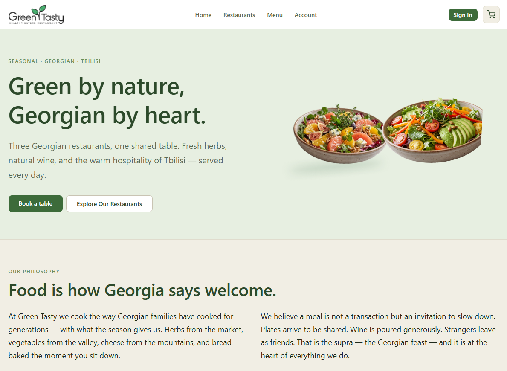
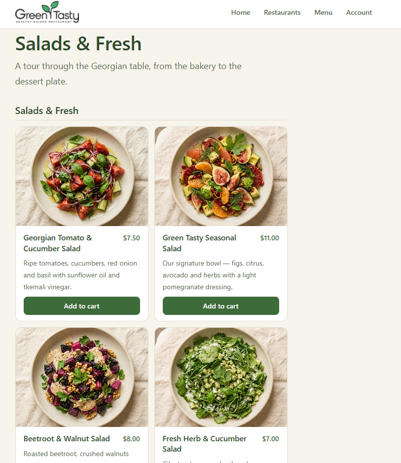
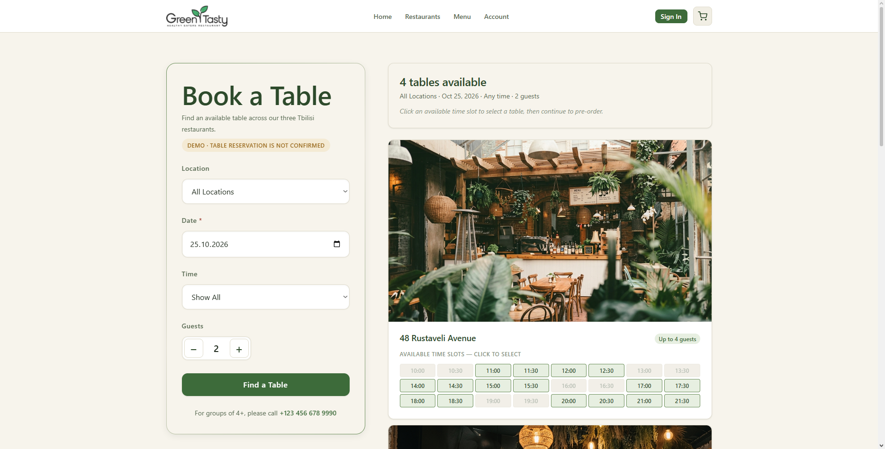

# Green Tasty

**Green by nature, Georgian by heart.**

A frontend demo for Green Tasty — a group of three Georgian restaurants in Tbilisi. Built as a portfolio project to demonstrate a complete restaurant experience, from browsing the menu and reserving a table to pre-ordering dishes and inviting friends to a shared order.

## Screenshots

### Home Page



### Menu



### Shared Order



## Tech Stack

- **React 18** — UI
- **Vite 5** — development server and build tool
- **React Router v6** — client-side routing
- **Plain CSS** — styling with CSS custom properties and design tokens
- **localStorage** — shared order persistence and cross-tab synchronization
- **React Context** — shared application state

No Tailwind CSS or UI component libraries. No backend integration; authentication is a demo, and data persistence varies by feature.

## Features

### Public Pages

- **Home** — hero section, restaurant philosophy, popular dishes, three locations, and a final call to action.
- **Restaurants** — listing of three demo restaurant locations.
- **Restaurant Details** — restaurant photos, descriptions, demo opening hours, and a table reservation CTA.
- **Menu** — Georgian food across five categories and drinks across three categories, with category navigation and add-to-cart functionality.

### Authentication Demo

- **Sign In / Sign Up** — forms with input validation.
- Form submission displays a message explaining that real authentication is not connected.
- **Explore Demo Account** — direct access to the account interface without signing in.

### Shopping Cart

- Add food and drinks from the menu.
- Increase or decrease item quantities.
- Remove individual items or clear the cart.
- Automatic subtotal and total calculation.
- Empty-cart state and checkout placeholder.

### Table Reservations

- Select a restaurant, date, time, and number of guests.
- View demo table availability with time-slot grids.
- Optionally pre-order food and drinks for the reservation.
- Review booking details and contact information before confirmation.
- View reservations in the account area.
- Open reservation details and cancel a demo booking.

### Shared Order

- Create a group order after confirming a demo reservation.
- Share an invitation link with friends.
- Let participants enter their names and add their own food and drinks.
- Display the group total and each participant's selections.
- Allow the organizer to close or reopen the collection.
- Synchronize shared order changes across browser tabs using `localStorage` and the `storage` event.

**Note:** Cross-device collaboration requires a shared backend. The current implementation uses browser storage and is intended as a frontend demonstration.

### Personal Account

- Overview with summary cards and the next reservation.
- Reservations list and booking details.
- Pre-order and contact information.
- Demo booking cancellation.
- Profile editing for the current session.
- Contact preferences and language settings.

## Project Structure

```text
src/
├── assets/                 # Restaurant, dish, hero, and logo images
├── components/             # Reusable UI components
│   ├── Header.jsx
│   ├── Footer.jsx
│   └── MenuCard.jsx
├── context/                # Shared application state
│   ├── CartContext.jsx
│   ├── PreorderContext.jsx
│   ├── ReservationsContext.jsx
│   └── SharedOrderContext.jsx
├── data/                   # Static restaurant and menu data
│   ├── restaurants.js
│   └── menu.js
├── pages/                  # Route-level components
│   ├── Home.jsx
│   ├── Restaurants.jsx
│   ├── RestaurantDetail.jsx
│   ├── Menu.jsx
│   ├── Cart.jsx
│   ├── Reservations.jsx
│   ├── Preorder.jsx
│   ├── Confirmation.jsx
│   ├── Account.jsx
│   ├── BookingDetail.jsx
│   ├── SharedOrder.jsx
│   ├── SignIn.jsx
│   ├── SignUp.jsx
│   └── NotFound.jsx
├── index.css               # Design tokens and global styles
├── App.jsx                 # Routing and context providers
└── main.jsx                # Application entry point
```

## Design System

The visual system is based on CSS custom properties defined in `src/index.css`.

- **Colors:** warm ivory, natural green, and soft neutral tones.
- **Typography:** system sans-serif font stack with a consistent type scale.
- **Spacing:** 4px-based spacing scale.
- **Border radii:** 4px, 8px, 12px, and pill-shaped elements.
- **Shadows:** subtle shadows with three levels of depth.
- **Motion:** 150ms and 200ms transitions, respecting `prefers-reduced-motion`.

The visual direction is natural, premium, and calm — without neon colors, glassmorphism, or heavy shadows.

## Getting Started

### Requirements

- Node.js 18 or newer
- npm

### Installation

```bash
npm install
```

### Development Server

```bash
npm run dev
```

### Production Build

```bash
npm run build
```

### Preview Production Build

```bash
npm run preview
```

## Demo Data and Limitations

- Three demo restaurant locations with provisional addresses.
- 20 food items and 12 bar items with illustrative prices in USD.
- Four mock tables with deterministic availability for demo time slots.
- Authentication is not connected to a real identity provider.
- Reservations and orders are demonstrations, not real bookings or purchases.
- Profile and settings changes may be session-only.
- Cart data is held in React state and resets when the application is reloaded.
- Shared orders use browser storage and are not synchronized between different devices.
- No real payment processing, email notifications, or backend availability checks.

## Roadmap

The frontend is structured to separate shared state (`context/`), static data (`data/`), and UI (`pages/` and `components/`).

Planned future improvements include:

- Supabase integration for authentication and persistent data.
- Server-backed reservations and real table availability.
- Cross-device shared order synchronization.
- Payment integration for reservation deposits.
- Email notifications and booking updates.

The current project provides a frontend foundation for these integrations while keeping the UI and state management organized.

## License

MIT — free to use for learning and portfolio purposes.
